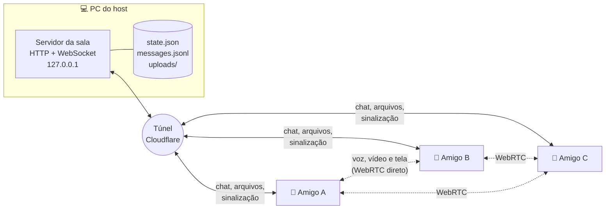
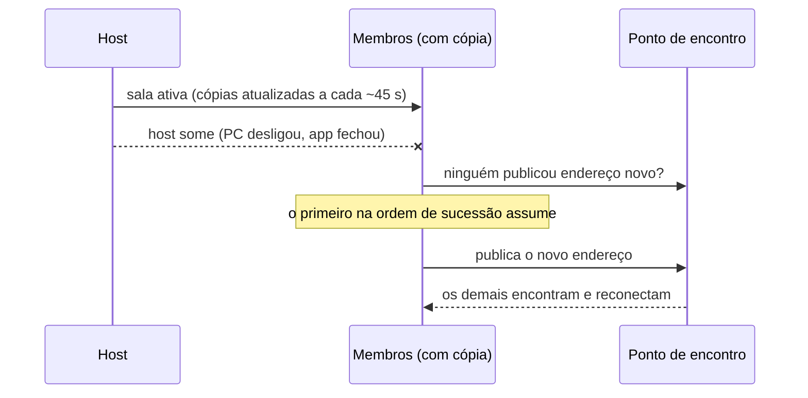

<div align="center">


# Concordo

**O chat do seu grupo de amigos, rodando no PC de um de vocês.**
Sem cadastro, sem servidor pago, sem anúncios.

[](https://github.com/Fialhoalves/Concordo/releases/latest)
[](package.json)


[**⬇ Baixar para Windows**](https://github.com/Fialhoalves/Concordo/releases/latest) ·
[Página do projeto](https://fialhoalves.github.io/Concordo/) ·
[Como usar](#como-usar) · [Como funciona](#como-funciona) · [Segurança](#segurança-e-privacidade)


</div>

---

## Por que o Concordo existe

Chats de grupo costumam exigir uma conta, uma empresa guardando suas conversas e, quando o grupo cresce, um servidor
que alguém precisa pagar. O Concordo parte de outra ideia: **o servidor é o computador de um amigo**. Quem hospeda abre
o app, gera um código de convite e pronto, a sala está no ar. Os outros entram com o código, e a voz e o vídeo vão direto
de um para o outro.

Os princípios que guiam o projeto:

- **Grátis de verdade.** Nada de plano pago, conta ou anúncio. Tudo usa serviços gratuitos (túnel da Cloudflare e GitHub).
- **Seus dados ficam com o grupo.** Mensagens e arquivos moram no computador do host e nas cópias de quem o grupo escolher.
- **A sala sobrevive ao host.** Se quem hospeda some, outro amigo assume com o mesmo histórico.
- **Segurança que não depende de confiar no host.** Mensagens assinadas, conversas diretas cifradas de ponta a ponta.
- **Simples para quem só quer conversar.** Instalar, colar um código, falar.
- **Honesto sobre os limites.** Pensado para grupos pequenos de amigos de confiança. O que ele não faz está descrito abaixo.

## O que dá para fazer

<table>
<tr>
<td width="50%" valign="top">

**💬 Conversar**
- Canais de texto, respostas, edição, fixar, buscar
- Formatação (`**negrito**`, `` `código` ``, citação), links e @menções
- Imagens e arquivos até 90 MB (cole com Ctrl+V)
- Reações com o mascote e emojis
- Enquetes com barras e votos ao vivo
- Confirmação de leitura ("Visto por…"), desligável
- Rascunho por canal e linha de "novas mensagens"

</td>
<td width="50%" valign="top">

**🎙️ Falar e ver**
- Voz, câmera e compartilhamento de tela, direto entre os apps
- Qualidade ajustável (até 1440p, 15/30/60 fps)
- Zoom e arrastar na tela compartilhada, janela flutuante
- Apertar para falar e atalhos globais de mudo
- Volume por pessoa, indicador de qualidade da conexão
- Soundboard com sons prontos e **sons enviados pela sala**
- Reações ao vivo durante a chamada

</td>
</tr>
<tr>
<td width="50%" valign="top">

**🔐 Segurança**
- Mensagens, edições e arquivos assinados (Ed25519)
- Conversas diretas cifradas de ponta a ponta (X25519 + AES-GCM)
- Chave fixada no primeiro contato, com aviso se mudar
- Dono, moderadores e membros; expulsar e banir
- Convites com validade, uso limitado e revogação

</td>
<td width="50%" valign="top">

**🏠 Salas e hosts**
- Hospede várias salas ao mesmo tempo
- Todos guardam uma cópia (sem tokens) para a sala sobreviver
- Sucessor assume sozinho se o host sumir, ou recebe a sala sem fechar o app
- Endereço do túnel muda? Os amigos reconectam sozinhos
- Perfil (foto, cor, situação), temas claro/escuro, silenciar canal
- Atualização automática pelo GitHub Releases

</td>
</tr>
</table>

## Como usar

<details open>
<summary><b>Quem hospeda a sala</b></summary>

1. Abra o Concordo e clique em **Hospedar**. Escolha um apelido e o nome da sala.
2. Espere o status ficar **Online**. O túnel abre sozinho (na primeira vez pode baixar o `cloudflared`).
3. Clique em **Convidar**, gere um convite e mande o código para o amigo.
4. Deixe o app aberto enquanto a galera estiver conversando. Fechar a janela só minimiza para a bandeja do sistema.

</details>

<details open>
<summary><b>Quem entra</b></summary>

1. Abra o Concordo, clique em **Entrar**, cole o código e escolha um apelido.
2. Nas próximas vezes a sala aparece em **Suas salas**; o app reencontra o endereço novo sozinho.
   Se não achar, o host manda um **código para quem já entrou** (no painel de convite) e você cola em **Entrar**,
   sem gastar convite.

</details>

<details>
<summary><b>Voz, vídeo e tela</b></summary>

1. Clique num canal de voz e em **Entrar na chamada** (o dono cria canais em **+ → Voz e vídeo**).
2. Na barra da chamada: silenciar, ensurdecer, câmera, compartilhar tela, reagir, soundboard e sair.
3. Clique num vídeo para destacá-lo. Na tela compartilhada, a roda do mouse dá zoom e arrastar move a imagem.
4. **Botão direito** no nome de alguém abre o volume da voz (0 a 200%), o volume da tela e *Silenciar para mim*.
5. O ⚙ ao lado do seu nome escolhe microfone, saída de som e câmera, cancelamento de eco e ruído, **apertar para falar** e a
   qualidade da transmissão (separada para câmera e tela).
6. Ao compartilhar a tela, o som do computador é opcional e desligado por padrão, porque inclui a voz dos amigos (use fones se ligar).

Atalhos globais (opcionais, em Configurações): **Ctrl+Shift+M** muta e **Ctrl+Shift+D** ensurdece mesmo com outro programa em foco.

</details>

<details>
<summary><b>Soundboard e sons da sala</b></summary>

Na chamada, o botão de alto-falante toca um som para todo mundo. Os sons prontos são sintetizados em cada computador (só o
nome do som viaja pela rede). Com **＋ Adicionar som** você envia um WAV, MP3 ou OGG de até 6 segundos e 200 KB para a sala
(3 por pessoa, 12 por sala). Quem enviou, o dono ou um moderador pode apagar.

</details>

<details>
<summary><b>Conversas diretas, cargos e moderação</b></summary>

- **Mensagem direta:** botão de balão no nome do membro. Só texto, cifrado de ponta a ponta. No topo da conversa há um
  **código de segurança**: se os dois virem o mesmo código (por ligação ou pessoalmente), ninguém está no meio.
- **Cargos:** o dono pode tornar alguém moderador. Moderadores apagam mensagens de membros, expulsam, banem e liberam chaves.
- **Trocou de computador?** O dono ou um moderador usa *Liberar chaves de segurança* no seu menu.
- **Banir** bloqueia a chave de segurança da pessoa. Se ela apagar os dados do app e gerar chave nova, um convite ainda a deixa
  entrar: a proteção real é só convidar quem você conhece.

</details>

## Como funciona



- **O servidor roda dentro do app do host** e só escuta em `127.0.0.1`. O acesso de fora vem de um
  [quick tunnel da Cloudflare](https://developers.cloudflare.com/cloudflare-one/connections/connect-networks/do-more-with-tunnels/trycloudflare/)
  (grátis, sem conta), com o `cloudflared` embutido no instalador.
- **O convite** é `concordo://join/<dados>` e carrega o endereço do túnel, o id da sala e um convite de uso limitado e
  validade de 24 h. Cada pessoa recebe um token próprio ao entrar.
- **Voz, vídeo e tela não passam pelo túnel.** São WebRTC direto entre os apps, em malha: cada pessoa envia para todas as
  outras. O servidor só repassa a sinalização.
- **O endereço do túnel muda** quando o host reinicia a sala. O host publica o endereço novo num ponto de encontro público
  gratuito, assinado com uma chave que só os membros têm, e os amigos o encontram sozinhos.
- **Tudo na tela é texto puro**: nada de HTML vindo de outras pessoas, e arquivos nunca são servidos como páginas.

### E se o host sumir?



Todo membro guarda, em segundo plano, uma cópia da sala (mensagens, arquivos e membros). As cópias **não levam tokens nem
convites**, então ninguém se passa por outro com uma cópia. A ordem de sucessão é a de entrada, e o dono pode escolher o
sucessor preferido (🛡️). Também dá para **passar a sala** sem fechar o app: o sucessor assume na hora e todos reconectam.
Se dois membros reabrirem ao mesmo tempo, a sala se corrige em segundos e as mensagens dos dois lados são juntadas por ID
(nada duplica nem some). O que chegou depois da última cópia (até ~45 s antes da queda) pode se perder.

## Segurança e privacidade

| Quem | O que enxerga |
|---|---|
| **Host** | Mensagens e arquivos dos canais, quem entrou e quando, e **quem conversa com quem** nas mensagens diretas (só o texto cifrado, sem o conteúdo). |
| **Cópias de membros** | O mesmo que o host, mas sem tokens nem convites. |
| **Cloudflare** | O tráfego do túnel (HTTPS). Não há conta nem dados do Concordo guardados lá. |
| **Quem está na chamada** | O seu endereço IP (a voz e o vídeo vão direto, sem intermediário). |

- **Assinaturas.** Cada pessoa tem um par de chaves por sala (Ed25519), guardado no computador de um jeito que o app usa mas
  ninguém consegue copiar. Mensagens, edições e arquivos saem assinados e todo mundo confere: selo de escudo quando está certo,
  vermelho se a assinatura não bate, amarelo se alguém que sempre assina mandou algo sem assinatura. Nem o host nem uma
  cópia conseguem fazer uma mensagem parecer de outra pessoa.
- **Mensagens diretas.** Chave combinada entre os dois (X25519) e texto cifrado com AES-GCM. O host guarda só o texto cifrado.
- **Chave fixada.** A chave de cada pessoa é guardada no primeiro contato; se mudar, o app avisa.
- **O que não é protegido:** votos de enquete (não são assinados, o host poderia alterar a contagem) e as mensagens dos
  canais para o host (não são cifradas, ele as guarda). Conversa sensível? Use mensagem direta.

O Concordo é feito para **grupos pequenos de amigos de confiança**. Não o use para segredos de alto risco.

## Limites conhecidos

- **O host precisa estar com o app aberto** (e o PC ligado). Se fechar sem passar a sala, ela fica fora do ar até alguém assumir.
- **Quick tunnels não têm garantia de disponibilidade.** Para endereço fixo, use um túnel nomeado da Cloudflare (precisa de
  conta e domínio; veja abaixo).
- **Arquivos:** até 90 MB cada (o plano grátis da Cloudflare corta uploads perto de 100 MB).
- **Windows avisa "app desconhecido"** na primeira instalação, porque o instalador não é assinado digitalmente. Clique em
  *Mais informações → Executar assim mesmo*. As atualizações seguintes não pedem isso de novo.
- **Chamadas:** até 8 pessoas por canal de voz, mas por ser malha o conforto real é de 4 a 5 (quem compartilha tela envia o
  vídeo para cada pessoa). Em redes muito restritivas a conexão direta pode falhar; o host pode configurar um servidor TURN.
- **Só Windows** por enquanto.

## Configurações avançadas (opcionais)

<details>
<summary><b>Endereço fixo (túnel nomeado da Cloudflare)</b></summary>

Na tela **Hospedar uma sala**, abra **Endereço fixo (avançado)**:

1. No Cloudflare Zero Trust, crie um túnel (Networks → Tunnels → Create tunnel → Cloudflared) e copie o **token**.
2. Em *Public hostname*, aponte o seu endereço (ex.: `chat.seudominio.com`) para `HTTP` + `localhost:47800`.
3. Cole o endereço e o token no Concordo. Ficam salvos só no seu computador (o token é criptografado pelo sistema).

Com isso o convite nunca muda. Se a porta 47800 estiver ocupada, troque no próprio campo (e no painel da Cloudflare).

</details>

<details>
<summary><b>Servidor TURN (para redes restritivas)</b></summary>

Por padrão o Concordo usa servidores STUN públicos para os computadores se acharem. Se alguém não conseguir entrar na chamada,
o host pode iniciar o app com um TURN próprio (ex.: coturn), definindo antes `CONCORDO_ICE_SERVERS` com uma lista JSON:

```powershell
$env:CONCORDO_ICE_SERVERS='[{"urls":"turn:meu-servidor:3478","username":"usuario","credential":"senha"}]'
& "$env:LOCALAPPDATA\Programs\Concordo\Concordo.exe"
```

A lista é entregue a todos os membros pelo servidor da sala.

</details>

<details>
<summary><b>Dados, cópias e consumo de internet</b></summary>

Os dados da sala ficam na pasta do aplicativo no computador do host (`host-data/<id da sala>`). Nas Configurações dá para
desligar a cópia da sala neste computador e escolher quais anexos guardar nas cópias (todos, até 10 MB ou nenhum). O
indicador no canto da barra lateral mostra o uso de internet e de disco (estimativas do que o app contou).

</details>

## Tecnologias

| Camada | O que usamos |
|---|---|
| App desktop | [Electron](https://www.electronjs.org/), instalador NSIS via electron-builder, atualização com electron-updater |
| Interface | HTML, CSS e JavaScript puros (sem framework e sem etapa de build), CSP restritiva e *preload* com lista de permissões |
| Servidor da sala | Node.js (`http` + [`ws`](https://github.com/websockets/ws)), persistência em arquivos (`state.json`, `messages.jsonl`, `uploads/`) |
| Acesso externo | Cloudflare quick tunnel (`cloudflared` embutido) e túnel nomeado opcional |
| Voz e vídeo | WebRTC em malha, STUN público e TURN opcional |
| Criptografia | WebCrypto: Ed25519 (assinaturas), X25519 + HKDF + AES-GCM (mensagens diretas), chaves não exportáveis no IndexedDB |
| Distribuição | GitHub Releases, com workflow que testa, empacota e publica |
| Testes | `node:test` (servidor, segurança, enquetes, mesclagem de cópias) e roteiros ponta a ponta com Playwright |

## Estrutura do código

```
src/main/       processo principal do Electron: janela, túnel, bandeja, atualização, cópias e ponto de encontro
src/server/     servidor de sala: HTTP, WebSocket, persistência, mesclagem de cópias
src/renderer/   interface (HTML/CSS/JS puro); voice.js (WebRTC), keys.js (criptografia), soundboard.js, meter.js
src/shared/     código usado pelos dois lados: convite, assinaturas, reações, lista de sons
test/           testes automatizados
docs/           página de apresentação (GitHub Pages)
```

## Desenvolvimento

Requer Node 20+.

```bash
npm install
npm start        # abre o app em modo desenvolvimento
npm test         # testes do servidor, da segurança e das cópias
npm run icons    # regenera src/renderer/icons.js depois de mexer em assets/icons/*.svg
```

Em desenvolvimento, o túnel usa o `cloudflared` de `build/bin/` (se existir) ou baixa um para a pasta do usuário. O app
permite uma instância por máquina; para testar com dois "amigos", use o código de convite em outro computador.

A identidade visual (cores, raios, tema escuro/claro/automático) vive em `src/renderer/styles/tokens.css`; o símbolo e o
mascote ficam em `src/renderer/assets/`.

### Publicar uma versão

É automático. Suba o número em `package.json` (e nas duas linhas de versão do `package-lock.json`) e faça commit na `main`.
O workflow `.github/workflows/release.yml` vê que a tag ainda não existe, roda os testes, gera o instalador do Windows e cria a
Release com `Concordo-Setup-X.Y.Z.exe`, `.blockmap` e `latest.yml`. Commits que não mudam a versão não geram Release. Quem já
tem o app recebe a atualização sozinho: ele confere ao abrir, baixa em segundo plano e mostra **Reiniciar e atualizar**.
Se o host atualizar com a sala aberta, a sala é encerrada (o app pede confirmação).

## Ideias para o futuro

- Pontos de encontro de reserva, para o endereço da sala não depender de um serviço só
- Não atualizar automaticamente durante uma chamada
- Exportar e restaurar uma sala
- Arquivos nas mensagens diretas
- Ícone e faixa da sala, emojis personalizados
- Servidor intermediário opcional (SFU) para chamadas com mais gente

Sugestões e problemas são bem-vindos nas [issues](https://github.com/Fialhoalves/Concordo/issues).

## Licença

[MIT](package.json). Feito com carinho para jogar conversa fora com os amigos.
